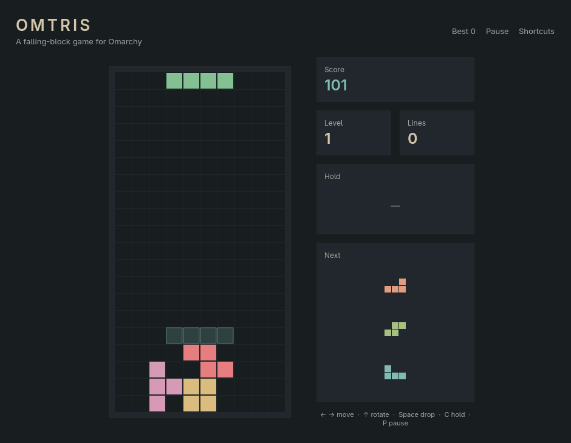

# Omtris



A falling-block game for [Omarchy](https://omarchy.org/). One window, one job,
driven from the keyboard, following the desktop theme live.

## Play

```sh
./bin/build
./build/omtris
```

| Key | Action |
| --- | --- |
| `←` `→` | Move |
| `↓` | Soft drop |
| `↑` / `X` | Rotate |
| `Z` | Rotate back |
| `C` | Hold piece |
| `Space` | Hard drop |
| `P` / `Esc` | Pause |
| `R` | Restart |
| `Enter` | Start / play again |
| `?` | Shortcuts |
| `Q` | Quit |

The next three pieces and the hold slot are on the right. A ghost shows where
the piece will land. Clearing lines scores 100 / 300 / 500 / 800 × level;
dropping scores 1 per cell (soft) or 2 per cell (hard). The best score is kept
in `~/.config/omarchy/omtris.conf`.

Clearing a line plays a short break sound; a four-line clear gets a bigger
flourish. The two WAVs are synthesized by `python3 tools/make_sounds.py` and
played through Qt Multimedia.

## Install as an Omarchy app

```sh
./bin/install
```

That builds the package with `makepkg`, installs the binary, the `.desktop`
entry, and the icon, so Omtris appears in the app launcher (`Super + Space`).

## Build and test

```sh
./bin/build   # qmake6 + make into build/omtris
./bin/test    # builds and runs the Qt Test suite offscreen
```

The game rules live in `src/backend.cpp`, exposed to QML as `backend`; the
tests drive them without a display.

## Omarchy integration

- **Theme:** the accent, the seven block colors, the window and panel colors,
  and the text colors are read from
  `~/.local/state/omarchy/current/theme/colors.toml` and re-read when the theme
  changes.
- **Corners:** the effective Hyprland `decoration:rounding` is asked for with
  `hyprctl`, so panels and blocks match the desktop's rounding.
- **Language:** the strings follow Setup > Language live, with English, Danish,
  and German catalogs in `src/i18n/`.
- **Packaging:** a `PKGBUILD` installs the binary, a translated `.desktop` entry,
  and an SVG icon.

## Layout

```text
omtris.pro              qmake project
bin/build               build into build/
bin/test                Qt Test suite, offscreen
bin/install             makepkg -fsi
src/main.cpp            app setup; hands C++ objects to QML
src/backend.{h,cpp}     board, pieces, scoring, hold, game state
src/theme.{h,cpp}       Omarchy colors, accent, Hyprland rounding
src/translator.{h,cpp}  Omarchy language catalogs
src/Main.qml            window, panels, overlays
src/Board.qml           the well, painted on a Canvas
src/PreviewBox.qml      next and hold previews
src/StatCard.qml        score, level, lines
src/HelpOverlay.qml     shortcut list
src/i18n/               en, da, de
src/sounds/             line-clear and four-line sounds
tests/omtris_tests.cpp  backend, theme, translator, sound signal
tools/make_sounds.py    synthesizes the two WAVs
pkgbuild/               PKGBUILD, desktop entry, icon
```

The theme and translator helpers are adapted from Omacut and Monologue
(MIT, David Heinemeier Hansson).